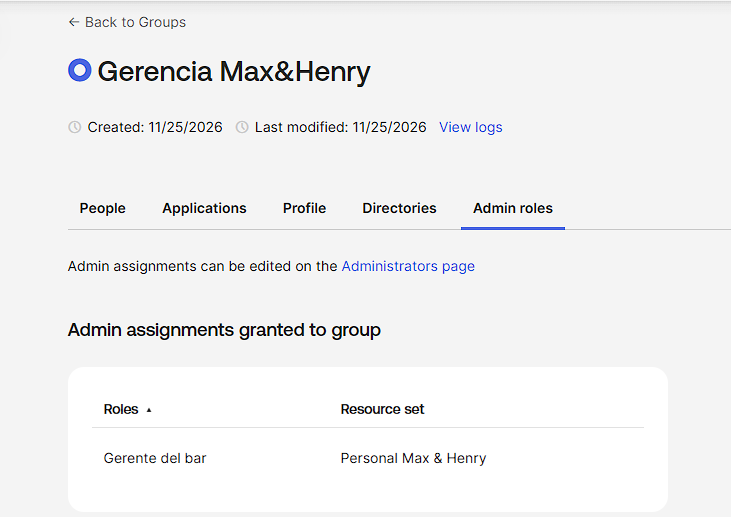
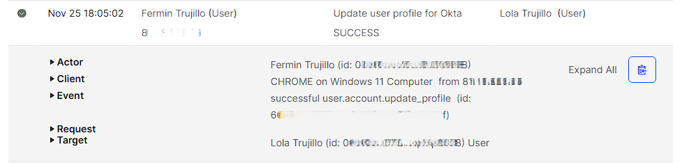
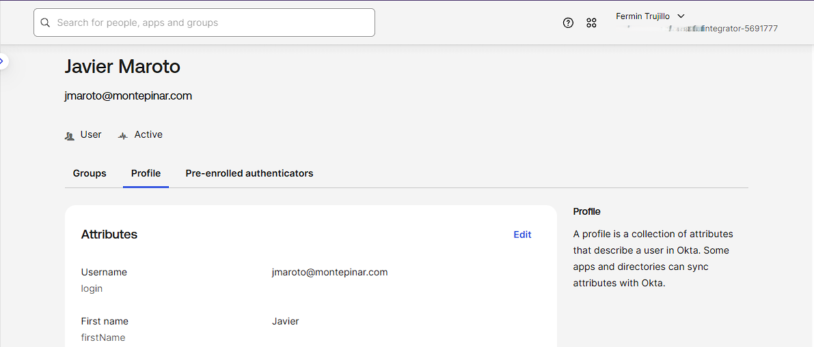
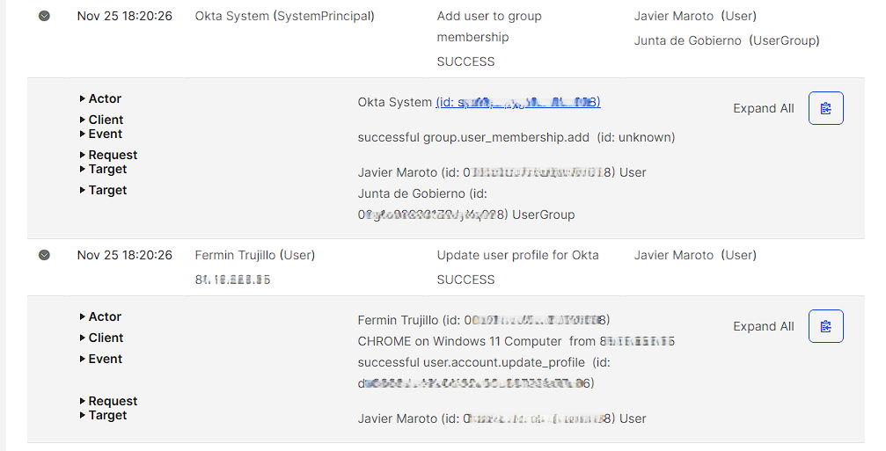

# Okta 02 — Un espetero con poderes limitados

## 1. Descripción del proyecto

Este laboratorio está inspirado en el episodio 7x04 de *La que se avecina*: **«Un espetero-hostelero, una agonía rural y unas gotitas de burundanga»**.

Fermín Trujillo, el espetero más peculiar de Mirador de Montepinar, se pone al frente del Max & Henry dispuesto a demostrar que también puede triunfar en el mundo de la hostelería. Para darle un impulso al negocio, decide organizar una fiesta de Halloween que termina convirtiéndose en un auténtico descontrol.

Trasladamos esta situación al entorno digital de **Mirador de Montepinar S. L.**, donde Fermín necesita gestionar las cuentas de los empleados y colaboradores de su establecimiento. Hasta ahora, cualquier modificación de usuarios debía realizarla un administrador general de la organización, incluso cuando se trataba de operaciones sencillas relacionadas exclusivamente con el bar.

Para agilizar estas tareas, surge una propuesta aparentemente razonable: conceder a Fermín permisos administrativos en Okta.

Sin embargo, entregar privilegios excesivos a alguien que acaba de hacerse cargo del Max & Henry podría provocar un problema de seguridad. Fermín no necesita administrar las cuentas de Mariscos Recio, modificar las identidades de los miembros de la Junta de Gobierno ni intervenir en las políticas de autenticación de toda la comunidad.

Ante esta situación, Enrique Pastor propone establecer un modelo de **administración delegada basado en el principio de mínimo privilegio**, de manera que Fermín pueda realizar únicamente las operaciones necesarias sobre las identidades vinculadas a su negocio.

El objetivo del laboratorio es implementar y validar este modelo mediante **Custom Admin Roles y Resource Sets de Okta**, definiendo tanto las operaciones administrativas permitidas como los recursos sobre los que pueden ejecutarse.

A través de distintas pruebas, se comprobará si Fermín puede consultar y modificar las identidades de su ámbito de responsabilidad, mientras se restringen las operaciones sobre usuarios ajenos al Max & Henry y las funciones administrativas que no necesita.

También se investigarán los riesgos asociados a la edición de atributos de identidad. En particular, se estudiará si una delegación demasiado amplia podría afectar indirectamente a las pertenencias automáticas configuradas en el laboratorio anterior, donde el atributo `cargoVecinal` determina quién pertenece a `Junta de Gobierno`.

Las pruebas incluirán operaciones autorizadas y denegadas, la comprobación de los permisos efectivos desde la cuenta de Fermín y la revisión de los eventos disponibles en **System Log**.

Este laboratorio permitirá profundizar en conceptos de *Identity and Access Management (IAM)* como **Role-Based Access Control (RBAC)**, administración delegada, separación de responsabilidades y mínimo privilegio.

**Escenario ficticio:** Mirador de Montepinar S. L., donde Fermín Trujillo acaba de descubrir que dirigir un bar también implica gestionar usuarios y permisos. Porque una cosa es darle las llaves del Max & Henry y otra muy distinta es permitirle administrar todo Montepinar.

## 2. Objetivos técnicos

El objetivo de este laboratorio es implementar un modelo de administración delegada en Okta que permita a Fermín Trujillo gestionar las identidades vinculadas al Max & Henry sin concederle privilegios administrativos sobre toda la organización.

Para ello, se establecen los siguientes objetivos:

1. **Aplicar el principio de mínimo privilegio:** conceder únicamente los permisos necesarios para consultar usuarios y modificar atributos de perfil.

2. **Configurar un Custom Admin Role:** crear el rol `Gerente del bar`, evitando permisos de suspensión, desactivación o restablecimiento de contraseñas.

3. **Delimitar el ámbito administrativo:** utilizar un Resource Set para restringir los usuarios administrables a los miembros del grupo `Max&Henry`.

4. **Delegar permisos mediante grupos:** asignar el rol y el Resource Set a `Gerencia Max&Henry`, cuyo miembro es Fermín Trujillo.

5. **Verificar los permisos efectivos:** iniciar sesión como Fermín y comprobar qué usuarios puede consultar y editar, así como las acciones administrativas que aparecen disponibles.

6. **Auditar las operaciones:** utilizar System Log para identificar las modificaciones realizadas por el administrador delegado.

7. **Investigar riesgos de autorización indirecta:** comprobar si la modificación del atributo `cargoVecinal` puede desencadenar cambios automáticos en `Junta de Gobierno`, aunque ese grupo quede fuera del ámbito administrativo de Fermín.

El laboratorio también contempla la resolución de incidencias de configuración y autenticación surgidas durante las pruebas.

## 3. Entorno y tecnologías utilizadas

El laboratorio se desarrolló en un entorno **Okta Integrator Free Plan**, reutilizando las identidades y las Group Rules configuradas en el laboratorio anterior.

### 3.1. Tecnologías y funcionalidades

| Tecnología | Aplicación en el laboratorio |
|---|---|
| Okta Universal Directory | Administración de identidades y atributos de perfil. |
| Okta Groups | Separación de usuarios administrados y administradores delegados. |
| Custom Admin Roles | Definición de permisos administrativos específicos. |
| Resource Sets | Delimitación de los usuarios sobre los que pueden ejercerse esos permisos. |
| Group Rules | Automatización de pertenencias mediante el atributo `cargoVecinal`. |
| Okta Account Management Policy | Investigación de un bloqueo durante la autenticación de Fermín. |
| System Log | Auditoría de modificaciones y cambios automáticos de pertenencia. |

### 3.2. Identidades utilizadas

| Usuario | Función en el laboratorio |
|---|---|
| Fermín Trujillo | Administrador delegado del Max & Henry. |
| Lola Trujillo | Usuaria administrada; utilizada para verificar modificaciones autorizadas. |
| Javier Maroto | Usuario administrado; utilizado para comprobar restricciones y efectos indirectos sobre grupos. |
| Antonio Recio | Usuario externo al ámbito administrativo de Fermín. |
| Super Administrator | Configuración de roles, recursos y comprobación independiente de resultados. |

### 3.3. Grupos utilizados

Se crearon dos grupos para separar las identidades administradas de quienes reciben permisos administrativos.

**Grupo `Max&Henry`**

Contiene los usuarios sobre los que Fermín podrá realizar las operaciones autorizadas.

Miembros:
- Lola Trujillo.
- Javier Maroto.

**Grupo `Gerencia Max&Henry`**

Contiene las identidades que reciben la asignación administrativa delegada.

Miembro:
- Fermín Trujillo.

También se reutilizó `Junta de Gobierno`, creado en el Lab 01, para investigar los efectos indirectos de la edición de atributos.

### 3.4. Modelo de administración delegada

La configuración administrativa quedó definida mediante los siguientes componentes:

| Componente | Configuración |
|---|---|
| Grupo administrador | `Gerencia Max&Henry` |
| Custom Admin Role | `Gerente del bar` |
| Permiso 1 | `View users and their details` |
| Permiso 2 | `Edit users' profile attributes` |
| Resource Set | `Personal Max & Henry` |
| Tipo de recurso | Users from group `Max&Henry` |

El Custom Admin Role determina **qué operaciones** puede realizar Fermín, mientras que el Resource Set delimita **sobre qué usuarios** puede ejecutarlas.

La asignación se realizó al grupo `Gerencia Max&Henry`, en lugar de conceder el rol directamente a Fermín. Esto permite mantener separadas la pertenencia administrativa y la definición de privilegios.

No se concedieron permisos específicos de gestión del ciclo de vida, restablecimiento de contraseñas ni administración global.

### 3.5. Configuración reutilizada del Lab 01

El entorno conservaba el atributo personalizado `cargoVecinal` y dos Group Rules activas:

| Regla | Condición | Acción |
|---|---|---|
| Presidencia de Montepinar | `cargoVecinal` equals `Presidente` | Añadir a `Junta de Gobierno` |
| Vicepresidencia de Montepinar | `cargoVecinal` equals `Vicepresidente` | Añadir a `Junta de Gobierno` |

Estas reglas permitieron investigar si un administrador delegado podía influir indirectamente en la pertenencia a un grupo fuera de su ámbito administrativo.

Durante las comprobaciones se confirmó que `Junta de Gobierno` no tenía aplicaciones ni roles administrativos asignados. Por tanto, una incorporación a ese grupo no suponía por sí misma una escalada de privilegios en el entorno probado.

## 4. Desarrollo del laboratorio

### 4.1. Preparación de los grupos y las identidades

Fermín Trujillo acaba de ponerse al frente del Max & Henry y necesita gestionar las identidades de las personas vinculadas al establecimiento.

El primer paso consistió en preparar dos grupos desde **Directory → Groups**, separando los usuarios que serían administrados de aquellos que recibirían los permisos administrativos.

**Grupo `Max&Henry`**

Se creó para delimitar las identidades relacionadas con el bar.

Sus miembros fueron:

- Lola Trujillo.
- Javier Maroto.

**Grupo `Gerencia Max&Henry`**

Se creó para representar a los responsables de la administración delegada del establecimiento.

Se incorporó a Fermín Trujillo como único miembro.

Esta separación permite conceder permisos a un grupo administrativo sin asignarlos individualmente a cada responsable del negocio.

Antes de comenzar, también se comprobó desde **Security → Administrators → Admins** que Fermín no tenía roles administrativos previamente asignados.

De este modo, las pruebas partirían de una identidad sin privilegios administrativos adicionales conocidos.

### 4.2. Creación del Custom Admin Role

Desde **Security → Administrators → Roles**, se creó un rol personalizado denominado:

**`Gerente del bar`**

Descripción: Administración limitada de perfiles de usuarios del Max & Henry.

Se habilitaron únicamente los siguientes permisos:

| Permiso | Función |
|---|---|
| `View users and their details` | Consultar usuarios y sus perfiles. |
| `Edit users' profile attributes` | Modificar atributos de los usuarios autorizados. |

No se seleccionaron permisos específicos para suspender usuarios, desactivarlos o restablecer sus contraseñas.

La intención era que Fermín pudiera actualizar información administrativa del personal, pero sin disponer de las capacidades necesarias para gestionar íntegramente el ciclo de vida de sus cuentas.

Durante la creación del rol se comprobó que la interfaz disponible no ofrecía una opción para establecer restricciones sobre atributos concretos.

Esta limitación resultó relevante posteriormente, cuando se investigó el efecto de modificar el atributo personalizado `cargoVecinal`.

### 4.3. Configuración del Resource Set

A continuación, desde **Security → Administrators → Resources**, se creó el Resource Set:

**`Personal Max & Henry`**

Su objetivo era limitar el ámbito administrativo de Fermín a las identidades vinculadas al bar.

La configuración definitiva utilizó el tipo de recurso **Users**, seleccionando los usuarios pertenecientes al grupo `Max&Henry`.

De este modo, el ámbito quedó definido mediante la pertenencia al grupo, sin necesidad de seleccionar individualmente a Lola y Javi.

Esta configuración permite separar dos componentes de la autorización:

- El Custom Admin Role determina las operaciones permitidas.
- El Resource Set delimita los recursos sobre los que pueden ejecutarse.

Durante la primera configuración se produjo un error al seleccionar el tipo de recurso `Groups`. Esta incidencia se detectó durante las pruebas y se corrigió posteriormente, tal como se explica en el apartado 6.

### 4.4. Asignación de los permisos administrativos

Con el rol y el Resource Set preparados, se realizó la asignación desde **Security → Administrators**.

| Elemento | Valor |
|---|---|
| Administrador | `Gerencia Max&Henry` |
| Custom Admin Role | `Gerente del bar` |
| Resource Set | `Personal Max & Henry` |

Como Fermín pertenecía a `Gerencia Max&Henry`, recibió los permisos administrativos asociados a esta asignación.

La configuración pudo consultarse desde la pestaña **Admin roles** del propio grupo.

**Evidencia 01 — Asignación administrativa**

La evidencia documenta la relación entre el grupo administrador, el rol personalizado y el ámbito de recursos.

### 4.5. Acceso de Fermín a la consola de administración

Una vez configurada la delegación, se inició sesión con Fermín Trujillo en una ventana independiente para comprobar sus permisos efectivos.

El primer intento de acceso no se completó correctamente.

Durante la investigación se identificó en **System Log** un evento con resultado `DENY` relacionado con la regla `Phishing resistant authenticator enrollment`, perteneciente a Okta Account Management Policy.

Tras resolver la incidencia de autenticación, Fermín pudo acceder a la Admin Console.

En **Directory → People** se comprobó que únicamente aparecían tres identidades:

| Usuario | Visibilidad |
|---|---|
| Fermín Trujillo | Visible |
| Lola Trujillo | Visible |
| Javier Maroto | Visible |
| Antonio Recio | No visible |

La visibilidad de la propia cuenta de Fermín no modificaba el ámbito administrativo definido para el personal del bar.

La comprobación confirmó que Fermín podía consultar las identidades de Lola y Javi, mientras que Antonio Recio y los demás usuarios ajenos al ámbito delegado no aparecían en su listado.

Este resultado se obtuvo después de corregir la configuración inicial del Resource Set.

### 4.6. Verificación de una modificación autorizada

Para comprobar que el rol permitía realizar operaciones de escritura, se utilizó la cuenta de Lola Trujillo.

Desde la sesión de Fermín se accedió a:

**Directory → People → Lola Trujillo → Profile → Edit**

Se modificó exclusivamente el atributo `Title`, asignándole el valor:

`Encargada del Max & Henry`

La modificación se guardó correctamente.

Posteriormente, desde la cuenta Super Administrator, se comprobó que el nuevo valor aparecía en el perfil de Lola.

La operación también quedó registrada en **Reports → System Log**:

| Campo | Resultado |
|---|---|
| Fecha | 25/11/2026 |
| Hora | 18:05:02 |
| Actor | Fermín Trujillo |
| Evento | Update user profile for Okta |
| Resultado | SUCCESS |
| Usuario afectado | Lola Trujillo |

**Evidencia 02 — Administración efectiva de usuarios**

La prueba permitió comprobar que los permisos concedidos eran suficientes para modificar atributos de un usuario incluido en el Resource Set.

### 4.7. Comprobación de las operaciones restringidas

La siguiente prueba se realizó sobre Javier Maroto, también perteneciente al grupo `Max&Henry`.

Desde la sesión de Fermín se accedió a su perfil y se comprobaron las acciones disponibles.

El administrador delegado podía consultar el perfil de Javi y editar sus atributos.

Sin embargo, no aparecían los controles administrativos para:

- Suspender la cuenta.
- Desactivar la cuenta.
- Restablecer la contraseña.

Tampoco se encontraron estas operaciones en un menú adicional de acciones.

**Evidencia 03 — Restricciones administrativas observadas**

El comportamiento observado era coherente con los permisos definidos en el Custom Admin Role.

Esta comprobación se realizó mediante la interfaz administrativa. No se ejecutaron solicitudes de API para verificar respuestas explícitas de autorización denegada.

### 4.8. Investigación de un riesgo de autorización indirecta

Una vez comprobados los permisos básicos, se investigó una posible consecuencia de permitir a Fermín modificar atributos de perfil sin restricciones adicionales.

En el laboratorio anterior se había creado el atributo personalizado `cargoVecinal`, utilizado por dos Group Rules:

- `Presidencia de Montepinar`.
- `Vicepresidencia de Montepinar`.

Estas reglas incorporan automáticamente a `Junta de Gobierno` a los usuarios cuyo cargo sea `Presidente` o `Vicepresidente`.

Aunque Fermín no tenía permisos administrativos directos sobre `Junta de Gobierno`, sí podía modificar el atributo `cargoVecinal` de Javier Maroto.

Se decidió comprobar si esa modificación podía desencadenar una incorporación automática al grupo.

**Estado inicial de Javier**

| Elemento | Valor |
|---|---|
| `cargoVecinal` | `ExPresidente` |
| Miembro de `Max&Henry` | Sí |
| Miembro de `Junta de Gobierno` | No |

Desde la sesión de Fermín se modificó el atributo:

`cargoVecinal: ExPresidente → Presidente`

Después del cambio, desde la sesión Super Administrator se comprobó que Javier había sido incorporado automáticamente a `Junta de Gobierno`.

La incorporación se produjo como consecuencia de la Group Rule `Presidencia de Montepinar`.

**Auditoría del cambio**

Se localizaron dos eventos relacionados en System Log:

| Hora | Actor | Evento | Resultado |
|---|---|---|---|
| 18:20:26 | Fermín Trujillo | Update user profile for Okta | SUCCESS |
| 18:20:26 | Okta System | Add user to group membership | SUCCESS |

Los eventos reflejan operaciones distintas.

Fermín modificó el perfil de Javier, mientras que Okta ejecutó la incorporación automática al grupo.

**Evidencia 04 — Cambio indirecto de pertenencia**

Esta prueba demostró que un administrador delegado podía provocar cambios de pertenencia en un grupo que no administraba directamente, mediante la modificación de un atributo utilizado por una regla automática.

No obstante, durante la investigación se comprobó que `Junta de Gobierno` no tenía aplicaciones ni roles administrativos asignados.

Por tanto, **se demostró un efecto indirecto sobre la pertenencia a grupos, pero no una escalada efectiva de privilegios**.

En un entorno empresarial, el impacto dependería de los accesos o permisos asociados al grupo afectado.

### 4.9. Restauración del estado inicial

Una vez completada la prueba, se restauró el atributo de Javier Maroto desde la sesión de Fermín:

`cargoVecinal: Presidente → ExPresidente`

Posteriormente, se comprobó desde la cuenta Super Administrator que Javier había dejado de pertenecer a `Junta de Gobierno`.

El usuario mantuvo su pertenencia a `Max&Henry`, por lo que continuó dentro del ámbito administrativo del bar.

Con esta restauración se evitó dejar modificaciones innecesarias en las reglas y pertenencias configuradas durante el laboratorio anterior.

## 5. Pruebas y resultados

Una vez configurada la administración delegada, se realizaron varias pruebas para comprobar los permisos efectivos de Fermín Trujillo y las restricciones aplicadas mediante el Custom Admin Role y el Resource Set.

### 5.1. Pruebas funcionales

| Prueba | Acción realizada | Resultado observado | Estado |
|---|---|---|---|
| 01. Acceso administrativo | Iniciar sesión como Fermín y acceder a la Admin Console. | Acceso correcto tras resolver una incidencia de autenticación. | Correcto |
| 02. Visibilidad de usuarios | Consultar Directory → People desde la cuenta de Fermín. | Aparecen Fermín, Lola y Javi. | Correcto |
| 03. Restricción del ámbito | Comprobar la presencia de Antonio Recio en el listado. | Antonio no aparece entre los usuarios visibles. | Correcto |
| 04. Modificación autorizada | Cambiar el atributo `Title` de Lola Trujillo. | El cambio se guarda y se verifica desde Super Administrator. | Correcto |
| 05. Auditoría de modificación | Buscar la actualización de Lola en System Log. | Evento `Update user profile for Okta` con resultado `SUCCESS`. | Correcto |
| 06. Restricciones administrativas | Examinar las acciones disponibles sobre Javier Maroto. | No aparecen opciones para suspender, desactivar o restablecer contraseñas. | Verificado en la interfaz |
| 07. Modificación de atributo personalizado | Cambiar `cargoVecinal` de Javi a `Presidente`. | Fermín puede guardar el cambio. | Correcto |
| 08. Pertenencia indirecta | Comprobar `Junta de Gobierno` después de modificar `cargoVecinal`. | Okta incorpora automáticamente a Javi mediante una Group Rule. | Confirmado |
| 09. Auditoría del cambio indirecto | Revisar los eventos de actualización de perfil y pertenencia. | Se identifican eventos `SUCCESS` de Fermín Trujillo y Okta System. | Correcto |
| 10. Restauración | Devolver `cargoVecinal` a `ExPresidente`. | Javi deja de pertenecer a `Junta de Gobierno`. | Correcto |

Las pruebas confirmaron que Fermín podía consultar y modificar los perfiles incluidos en su ámbito administrativo, mientras que los usuarios ajenos al Max & Henry no aparecían en su listado.

No se realizaron pruebas de escritura sobre usuarios externos mediante API. Por tanto, la restricción del ámbito se verificó a través de la visibilidad y las operaciones disponibles en la consola administrativa.

### 5.2. Hallazgo de seguridad: autorización indirecta mediante atributos

La prueba más relevante surgió al investigar las consecuencias del permiso `Edit users' profile attributes`.

Inicialmente, el diseño parecía suficientemente limitado: Fermín podía administrar únicamente las identidades de Lola y Javi.

Sin embargo, ambos usuarios disponían del atributo personalizado `cargoVecinal`, utilizado por las Group Rules del laboratorio anterior.

Al modificar el atributo de Javier Maroto de `ExPresidente` a `Presidente`, Fermín desencadenó una incorporación automática a `Junta de Gobierno`.

La operación quedó reflejada mediante dos eventos:

**Acción directa**

- Actor: Fermín Trujillo.
- Evento: `Update user profile for Okta`.
- Usuario afectado: Javier Maroto.
- Resultado: `SUCCESS`.

**Consecuencia automática**

- Actor: Okta System.
- Evento: `Add user to group membership`.
- Usuario afectado: Javier Maroto.
- Grupo: `Junta de Gobierno`.
- Resultado: `SUCCESS`.

Ambos eventos se registraron el 25 de noviembre de 2026 a las 18:20:26.

Este comportamiento demuestra que **limitar los usuarios que puede administrar una identidad no necesariamente limita todos los efectos de modificar sus atributos**.

Aunque Fermín no administraba directamente `Junta de Gobierno`, podía provocar cambios en su composición mediante una regla automática.

### 5.3. Evaluación del impacto

Durante las pruebas se comprobó que `Junta de Gobierno` no tenía aplicaciones ni roles administrativos asignados.

En consecuencia, la incorporación de Javier no supuso una escalada efectiva de privilegios en el entorno utilizado.

No obstante, el comportamiento observado representa un riesgo potencial en organizaciones donde los grupos determinan el acceso a aplicaciones, información o recursos sensibles.

Para reducirlo sería necesario evaluar qué administradores pueden modificar los atributos utilizados en decisiones de acceso y aplicar controles adicionales cuando corresponda.

Estas medidas se identificaron como recomendaciones; no se implementaron durante el laboratorio.

### 5.4. Resultado final

El modelo de administración delegada funcionó para las operaciones previstas:

- Fermín pudo consultar y editar los perfiles de Lola y Javi.
- Antonio Recio permaneció fuera de su ámbito visible.
- Las operaciones sensibles de ciclo de vida no aparecían disponibles en la interfaz.
- Las modificaciones se registraron en System Log.

La prueba de `cargoVecinal` también demostró que el alcance de una delegación administrativa debe evaluarse considerando las automatizaciones que dependen de los atributos modificables.

Al finalizar, Javier recuperó su valor original `ExPresidente` y dejó de pertenecer a `Junta de Gobierno`.

**Resultado del laboratorio:** administración delegada funcional, restricciones observadas en la consola y un riesgo de autorización indirecta identificado mediante pruebas y registros de auditoría.

## 6. Problemas encontrados y decisiones técnicas

Durante el laboratorio surgieron dos incidencias que impidieron inicialmente completar las pruebas. Ambas se investigaron y resolvieron antes de continuar.

También se identificó una limitación de seguridad en el diseño de permisos.

### 6.1. Resource Set configurado con un tipo de recurso incorrecto

La primera configuración de `Personal Max & Henry` utilizó el tipo de recurso:

`Groups → Max&Henry`

Sin embargo, el Custom Admin Role `Gerente del bar` contenía permisos para consultar y editar usuarios.

Al iniciar sesión como Fermín, la consola mostraba únicamente su propia identidad. Lola y Javi no aparecían en el listado.

Para investigar el problema, se revisó la configuración del rol y la vista previa del Resource Set.

Se comprobó que el Resource Set contenía recursos de tipo `Groups`, mientras que los permisos definidos estaban orientados a operaciones sobre usuarios.

**Solución aplicada**

Se editó el Resource Set existente y se sustituyó la selección inicial por:

`Users → Add users from the following groups → Max&Henry`

No fue necesario eliminar el Resource Set ni recrear el Custom Admin Role.

Después de guardar los cambios y actualizar la sesión de Fermín, aparecieron Lola Trujillo y Javier Maroto en **Directory → People**.

**Conclusión técnica:** un Resource Set puede estar correctamente creado y asignado, pero contener recursos que no correspondan a los permisos del rol asociado.

Por eso, durante la validación de la administración delegada es necesario comprobar tanto los permisos concedidos como el tipo y alcance de los recursos incluidos.

### 6.2. Bloqueo de autenticación por Okta Account Management Policy

Durante el primer intento de inicio de sesión con Fermín, Okta rechazó una operación relacionada con la autenticación.

En **Reports → System Log** se identificó el siguiente evento:

| Campo | Resultado |
|---|---|
| Fecha | 25/11/2026 |
| Hora | 17:52:01 |
| Actor | Fermín Trujillo |
| Evento | Evaluation of Okta Account Management Policy |
| Resultado | DENY |
| Regla | Phishing resistant authenticator enrollment |

La regla exigía la utilización de dos tipos de factores y contemplaba métodos como contraseña, Okta Verify y passkeys.

Tras revisar y resolver la configuración de autenticación, Fermín pudo acceder a la Admin Console.

Esta incidencia permitió diferenciar dos controles de seguridad que intervienen en momentos distintos:

**Autenticación:** determina si una identidad puede completar el proceso necesario para acceder a un recurso.

**Autorización:** determina qué operaciones puede realizar una identidad después de autenticarse.

La asignación del Custom Admin Role no eliminaba los requisitos de autenticación establecidos por las políticas de Okta.

La investigación se apoyó en System Log para identificar la regla implicada.

### 6.3. Limitación de los permisos de edición de atributos

Durante la creación del Custom Admin Role se comprobó que la interfaz disponible no ofrecía una opción para restringir la edición de atributos concretos.

El permiso `Edit users' profile attributes` permitió a Fermín modificar el atributo personalizado `cargoVecinal` de Javier Maroto.

Esta capacidad resultó relevante porque dicho atributo intervenía en una Group Rule que determinaba la pertenencia a `Junta de Gobierno`.

**Problema identificado:** un administrador con permisos limitados a determinados usuarios podía provocar efectos sobre un grupo ajeno a su ámbito de administración mediante la edición de atributos.

**Comportamiento demostrado:** Javier fue incorporado automáticamente a `Junta de Gobierno` después de que Fermín cambiara su atributo a `Presidente`.

El cambio quedó registrado en System Log y fue revertido posteriormente.

**Decisión adoptada:** conservar el diseño del laboratorio para documentar el comportamiento observado y sus implicaciones de seguridad, sin introducir cambios adicionales en las reglas existentes.

En un entorno empresarial sería necesario estudiar mecanismos que impidan a los administradores delegados modificar atributos utilizados para conceder accesos sensibles.

La disponibilidad de restricciones por atributo dependería de las funcionalidades y condiciones del entorno de Okta.

### 6.4. Diferenciar restricciones observadas de denegaciones verificadas

Durante las pruebas se comprobó que Fermín no disponía en la interfaz de opciones para suspender, desactivar o restablecer contraseñas de los usuarios administrados.

Este comportamiento era coherente con los permisos configurados en `Gerente del bar`.

Sin embargo, no se realizaron solicitudes directas a la API para obtener respuestas explícitas de autorización denegada.

Por tanto, el resultado se documentó como **restricción verificada en la interfaz**, sin presentarlo como una prueba completa de denegación por API.

Esta distinción permite reflejar con precisión el alcance de las comprobaciones realizadas.

## 7. Conclusiones

La gestión del Max & Henry permitió implementar y comprobar un modelo de **administración delegada en Okta**, aplicando los principios de Role-Based Access Control (RBAC) y mínimo privilegio.

Mediante un Custom Admin Role y un Resource Set, se concedieron a Fermín Trujillo permisos para consultar y modificar los perfiles de los usuarios vinculados al establecimiento, sin asignarle un rol de Super Administrator.

Las pruebas realizadas desde su propia cuenta confirmaron que podía administrar a Lola Trujillo y Javier Maroto. Por el contrario, Antonio Recio y el resto de las identidades ajenas al ámbito delegado no aparecían en su listado de usuarios.

También se comprobó que Fermín no disponía en la interfaz de las opciones necesarias para suspender, desactivar o restablecer contraseñas.

La modificación autorizada del atributo `Title` de Lola quedó registrada en System Log con resultado `SUCCESS`, demostrando que las operaciones del administrador delegado podían auditarse.

### El principal hallazgo: los permisos pueden tener efectos indirectos

La parte más relevante del laboratorio surgió al investigar el atributo personalizado `cargoVecinal`, utilizado por las Group Rules configuradas en Okta 01.

Aunque Fermín no administraba directamente `Junta de Gobierno`, consiguió incorporar a Javier Maroto a ese grupo modificando su atributo de `ExPresidente` a `Presidente`.

System Log permitió distinguir las dos operaciones: Fermín actualizó el perfil del usuario y Okta System ejecutó la incorporación automática mediante una Group Rule.

Esta prueba puso de manifiesto una limitación del diseño: **controlar qué usuarios puede editar un administrador no garantiza que los efectos de esas modificaciones queden restringidos al mismo ámbito**.

En este caso no se produjo una escalada efectiva de privilegios, ya que `Junta de Gobierno` no tenía aplicaciones ni roles administrativos asignados. Sin embargo, en un entorno empresarial, un comportamiento similar podría afectar al acceso a recursos protegidos mediante grupos.

El hallazgo demuestra la importancia de evaluar las dependencias entre atributos, reglas automáticas y autorizaciones antes de conceder permisos de edición de perfiles.

### Competencias IAM trabajadas

- Configuración de Custom Admin Roles y Resource Sets.
- Delegación de permisos mediante grupos de administradores.
- Aplicación práctica de RBAC y mínimo privilegio.
- Validación de permisos efectivos desde una cuenta delegada.
- Diferenciación entre controles de autenticación y autorización.
- Diagnóstico de errores de configuración de recursos.
- Auditoría de modificaciones y cambios automáticos mediante System Log.
- Identificación de riesgos de autorización indirecta asociados a atributos y Group Rules.

### Mejoras identificadas

En un entorno empresarial, el diseño podría reforzarse mediante controles adicionales sobre los atributos utilizados para tomar decisiones de acceso.

También sería conveniente ampliar la validación con pruebas de autorización mediante API y revisar periódicamente las asignaciones administrativas para detectar permisos innecesarios.

Estas mejoras no se implementaron durante el laboratorio.

**Resultado final:** se verificó una administración delegada funcional, con permisos limitados sobre un conjunto específico de usuarios. Además, se identificó y reprodujo un riesgo de autorización indirecta derivado de la interacción entre la edición de atributos y las Group Rules.

Fermín Trujillo ya puede gestionar al personal del Max & Henry sin convertirse en administrador de todo Montepinar. Eso sí, hemos descubierto que tocar el atributo equivocado puede terminar metiendo a Javi otra vez en la Junta de Gobierno. Incluso en Okta, el espetero consigue montar un lío.

## 8. Referencias

### Documentación oficial de Okta

- [Okta — Custom Admin Roles](https://help.okta.com/oie/en-us/content/topics/security/custom-admin-role/about-creating-custom-admin-roles.htm)
- [Okta — Role Permissions](https://help.okta.com/oie/en-us/content/topics/security/custom-admin-role/about-role-permissions.htm)
- [Okta — Create a Resource Set](https://help.okta.com/oie/en-us/content/topics/security/custom-admin-role/create-resource-set.htm)
- [Okta — Edit a Resource Set](https://help.okta.com/oie/en-us/content/topics/security/custom-admin-role/edit-resource-set.htm)
- [Okta — Create an Admin Assignment Using a Resource Set](https://help.okta.com/oie/en-us/content/topics/security/custom-admin-role/create-admin-role-assignment-by-resource-set.htm)
- [Okta — Group Rules](https://help.okta.com/en-us/Content/Topics/users-groups-profiles/usgp-about-group-rules.htm)
- [Okta — System Log](https://help.okta.com/oie/en-us/Content/Topics/Reports/Reports_SysLog.htm)

### Referencia del episodio

- [La que se avecina — Temporada 7, episodio 4: «Un espetero-hostelero, una agonía rural y unas gotitas de burundanga»](https://www.formulatv.com/series/la-que-se-avecina/capitulos/15310/)

### Laboratorio relacionado

- [Okta 01 — Un presidente, unos privilegios y un Cuqui descontrolado](https://github.com/Malastro/Okta-01-Un-cuqui-presidente-)

El laboratorio utiliza identidades y situaciones ficticias inspiradas en *La que se avecina*. Las configuraciones técnicas y las pruebas descritas se realizaron en un entorno de prácticas de Okta.
